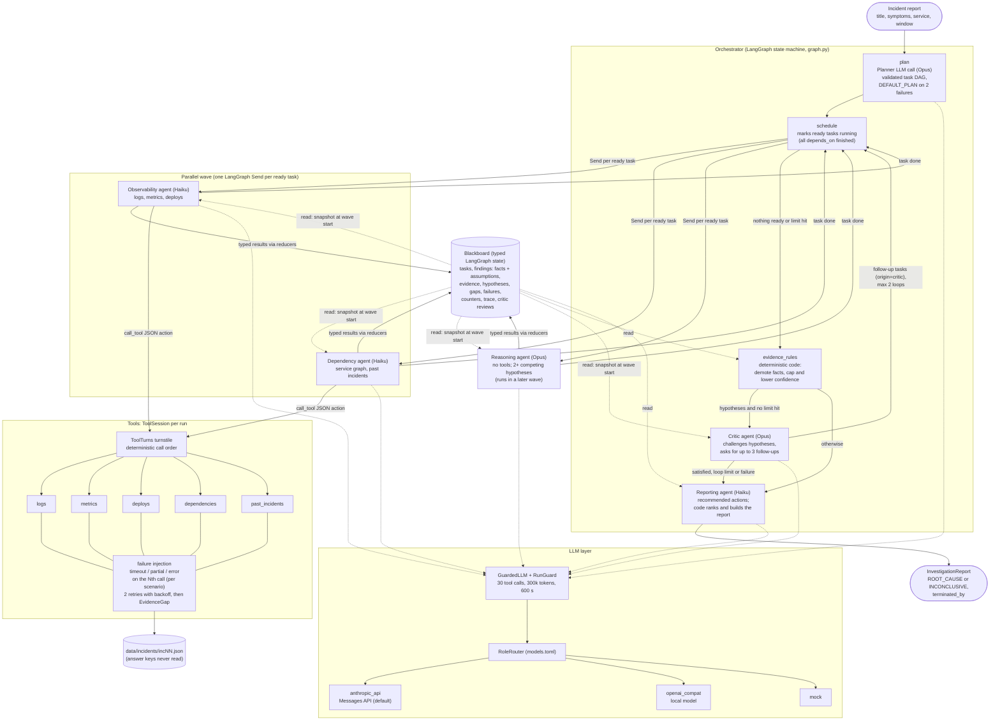

# Incident Investigator

A multi-agent system that investigates simulated production incidents. It finds probable root causes and recommends corrective actions, and every claim cites evidence. When the evidence is too weak, it says `INCONCLUSIVE`.

Six agents work together through a shared, typed blackboard and a task DAG. An Orchestrator plans the work. Observability and Dependency agents gather evidence in parallel through five tools. A Reasoning agent builds competing hypotheses. A Critic can send the investigation back for more evidence. A Reporting agent writes the recommended actions. Deterministic code checks the evidence and sets the final confidence.

The repository also has a single-agent baseline with the same tools, limits and report schema, 10 hand-written incidents with answer keys, an evaluation runner with an LLM judge, a CLI and an HTTP API.

It was built for the AI Engineer assignment in `orange_invest_assignment.md`. The design record is `DECISIONS.md`. The requirements are in `incident-investigator-ai-ready-prd.md`.

- [Setup](#setup)
- [Run an investigation (CLI)](#run-an-investigation-cli)
- [HTTP API](#http-api)
- [Tests](#tests)
- [Evaluation](#evaluation)
- [Evaluation results](#evaluation-results)
- [Architecture](#architecture)
- [How the agents coordinate](#how-the-agents-coordinate)
- [Project layout](#project-layout)
- [Coding-assistant transcript](#coding-assistant-transcript)
- [Unfinished features and external dependencies](#unfinished-features-and-external-dependencies)
- [Technical note](docs/technical-note.md)
- Design documents (interactive HTML, open in a browser): [system design](docs/design/system-design.html) and [data flow](docs/design/data-flow.html)

## Setup

You need:

- macOS or Linux.
- [uv](https://docs.astral.sh/uv/). uv installs Python 3.12 for you if it is missing (`requires-python = ">=3.12,<3.13"`).
- For live runs: an Anthropic API key in `ANTHROPIC_API_KEY`. The `anthropic_api` backend is the default for every role. Calls are billed to that key.

Steps:

1. Install the dependencies (the versions are locked in `uv.lock`):

   ```sh
   uv sync
   ```

2. Export your Anthropic API key for live runs:

   ```sh
   export ANTHROPIC_API_KEY=sk-ant-...
   ```

3. Check the install without using any LLM. The `mock` backend is an offline stand-in:

   ```sh
   uv run investigate inc01 --llm mock
   ```

   It prints `ROOT_CAUSE: report written to runs/inc01__multi.json`.

One other backend is optional:

- **A local model** (Ollama, LM Studio, vLLM) through an OpenAI-compatible endpoint: use `--llm openai_compat`, or set `backend = "openai_compat"` for single roles in `src/incident_investigator/models.toml`. The base URL comes from `$OPENAI_COMPAT_BASE_URL`, then `[backends.openai_compat] base_url` in `models.toml`, then `http://localhost:11434/v1`. `$OPENAI_COMPAT_API_KEY` is sent as a bearer token when it is set.

### Models

`src/incident_investigator/models.toml` sets the backend and model for each role. The defaults (DECISIONS.md Q8):

| Role | Model |
|---|---|
| planner (Orchestrator), reasoning, critic, baseline, judge | `claude-opus-5-5` |
| observability, dependency, reporting | `claude-haiku-5-5` |

All roles use the `anthropic_api` backend by default. `--llm <backend>` on the CLI or the evaluation overrides the backend for every role.

### How Claude is called

Each LLM call is one Messages API request through the official `anthropic` SDK: the agent's system prompt as `system`, and the prompt as one user turn. The SDK's own retries are off, because the agent loop owns retries. At most 3 LLM calls run at the same time, and each call has a 120 s timeout. A `429` rate limit stops an evaluation cleanly (exit 4, resumable). A rejected key (`401` or `403`) stops the run at the first call (exit 3), so a bad key never produces a report built from failed calls. Any other API error, including a `529` overload, is one failed attempt that the agent loop retries. An earlier version also called Claude through the subscription `claude -p` CLI; it was removed (ADR 0002).

### Key dependency versions (from `uv.lock`)

| Package | Version |
|---|---|
| Python | 3.12 (tested with 3.12.16) |
| langgraph | 1.2.20 |
| pydantic | 2.14.3 |
| fastapi | 0.162.5 |
| uvicorn | 0.54.0 |
| anthropic | 2.8.0 |
| httpx | 0.28.1 |
| pytest (dev) | 9.2.0 |
| pyright (dev) | 1.1.414 |

## Run an investigation (CLI)

```sh
uv run investigate <incident_id> [--mode multi|single] [--llm anthropic_api|openai_compat|mock] [--out runs]
```

- `incident_id`: `inc01` to `inc10` (the files in `data/incidents/`).
- `--mode multi` (default): the multi-agent graph. `--mode single`: the single-agent baseline.
- `--llm`: the backend for every role. Without it, each role uses its backend from `models.toml` (`anthropic_api` for all). Use `--llm mock` to run offline.
- `--out`: the output folder (default `runs/`, which git ignores).

Examples:

```sh
uv run investigate inc01 --mode multi               # live, billed to ANTHROPIC_API_KEY
uv run investigate inc01 --mode single --llm mock   # offline
```

Each run writes two files:

- `runs/<incident>__<mode>.json`: the `InvestigationReport`. It has the outcome (`ROOT_CAUSE` or `INCONCLUSIVE`), ranked hypotheses with supporting and contradicting evidence IDs and confidence, facts, assumptions, recommended actions, evidence gaps, metrics (tool calls, LLM calls, tokens in/out/cache, latency), `terminated_by`, the evidence-rule adjustments and the agent failures.
- `runs/<incident>__<mode>.trace.json`: the full blackboard. It has the plan and tasks, every finding, every evidence row the tools returned, the hypotheses, gaps, failures, Critic reviews, counters and a task trace with start and end times per task.

Exit codes: 0 done, 2 unknown incident, 3 the LLM backend is unusable (`ANTHROPIC_API_KEY` is not set, or the API rejected it). No report is written for 2 or 3.

## HTTP API

```sh
uv run api                     # serves on http://127.0.0.1:8000
uv run api --port 8080 --results-dir runs/api
```

Swagger UI is at <http://127.0.0.1:8000/docs>. The API calls the same `investigate()` function as the CLI and uses the backends from `models.toml` (`anthropic_api` by default). There is no `--llm` option, so every investigation you start through the API is billed to `ANTHROPIC_API_KEY`. Export the key before `uv run api`.

| Method and path | What it does |
|---|---|
| `POST /investigations` | Starts an investigation in the background. Body: `{"incident_id": "inc01", "mode": "multi"}`, or `incident_report` (an incident report object) in place of `incident_id`. Returns `202 {"id": "<hex>"}`. An unknown incident returns 404 and starts nothing. An invalid body returns 422. |
| `GET /investigations/{id}` | Returns `{id, status, mode, incident_id, created_at, finished_at, report, blackboard, error}`. `status` is `pending`, `running`, `done` or `failed`. `report` and `blackboard` are set when it is `done`. An unknown ID returns 404. |
| `GET /incidents` | Lists the dataset incidents: `[{id, title, affected_service, severity}]`. |

Example:

```sh
curl -s http://127.0.0.1:8000/incidents
curl -s -X POST http://127.0.0.1:8000/investigations \
  -H 'Content-Type: application/json' \
  -d '{"incident_id": "inc01", "mode": "multi"}'
# {"id":"f88fc79a607a4df2b37731ca10ebf3d7"}
curl -s http://127.0.0.1:8000/investigations/f88fc79a607a4df2b37731ca10ebf3d7
```

At most 2 investigations run at the same time. State is kept in memory and in one JSON file per investigation under `runs/api/`, so finished results survive a restart. An inline `incident_report` has no telemetry behind it, so every tool returns no evidence and the run ends `INCONCLUSIVE`.

## Tests

```sh
uv run pytest      # 359 tests, about 25 s, no LLM calls (mock LLM and scripted fakes)
uv run pyright     # type check of src/ and tests/
```

The tests cover the dataset and answer keys, the tools and failure injection, the LLM backends (a fake Anthropic SDK client and mocked HTTP), the agent loop, the planner and parallel waves, the evidence rules, the Critic loop and run limits, the baseline, the CLI, the API, scoring, the evaluation runner and the judge. Some tests guard fairness and honesty: no agent code path reads `data/answer_keys/`, `src/` has no hard-coded incident IDs or answer-key service names, and both systems read the same limits object. Another test keeps the technical note at 500 words or fewer.

## Evaluation

The evaluation runs both systems on all 10 incidents, scores each report, asks an LLM judge for a second opinion, and writes a summary.

```sh
uv run eval --all                       # live: both systems, then the judge, then summary.md
uv run eval --all --llm mock            # offline smoke test (run name "mock")
uv run eval --all --no-judge            # deterministic scores only
uv run eval --judge-only --run live     # judge the results an existing run already has
uv run eval --incidents inc01,inc02 --systems single   # a subset
```

- **Where results land:** `eval/results/<run>/`. The run name is `live` by default, or the `--llm` backend name (for example `mock`). Change it with `--run <name>` and the folder with `--results-dir`.
- **Files:** one `<incident>__<system>.json` per pair (the report, the deterministic scores and the judge verdict), a `<incident>__<system>.trace.json` next to it (the full blackboard), and `summary.md`.
- **Resume:** each pair is saved as soon as it finishes. If the run is killed or stops at a rate limit, run the same command again. It skips the pairs that already have a result file and judges only the pairs that have no verdict yet. On a rate limit (HTTP 429), the runner saves what is done, prints the exact resume command (for example `uv run eval --all --run live`) and exits 4.
- **Exit codes:** 0 done, 2 unknown incident (or nothing to judge with `--judge-only`), 3 preflight failed or the API rejected the key (the resume command is printed; fix the key first), 4 stopped by a rate limit.
- **Cost:** a live run is 20 investigations plus 20 judge calls, mostly on Opus, billed to `ANTHROPIC_API_KEY`. Each investigation is capped at 300k tokens (input + output), and the summary reports the tokens each system used.

If your shell or sandbox blocks commands that contain the word `eval`, run the module directly. The flags are the same:

```sh
uv run python -m incident_investigator.evaluation.runner --all --llm mock
```

## Evaluation results

> **Status: the live investigations ran on 2026-11-13 (20 of 20 pairs, one run each), and the LLM judge scored all 20.** Raw results and traces are in [`eval/results/live/`](eval/results/live/). The investigations were sent through the HTTP API (`uv run api`), which calls the same `investigate()` as `uv run eval`, and each pair was scored and saved in the runner's own result format, so the runner resumes and judges them as usual.

To produce them:

```sh
uv run eval --all
```

The summary is written to **`eval/results/live/summary.md`**. Commit the whole `eval/results/live/` folder with the results: `.gitignore` keeps it and ignores every other run folder (for example `eval/results/mock/`).

<!-- LIVE RESULTS: paste the aggregate tables from eval/results/live/summary.md below, or replace this block with a link to that file. -->

**Live results** (from [`eval/results/live/summary.md`](eval/results/live/summary.md); every role on `anthropic_api` with the models in `models.toml`; code at commit `cd5e31c`):

| System | Pairs | Accuracy | Grounding (mean) | Citations (grounded/total) | Tool calls | LLM calls | Tokens in | Tokens out | Latency s |
|---|---|---|---|---|---|---|---|---|---|
| multi | 10 | 8/10 (80%) | 0.997 | 812/814 | 23.2 | 35.2 | 105,068 | 33,017 | 185.0 |
| single | 10 | 9/10 (90%) | 1.000 | 307/307 | 8.0 | 10.0 | 26,371 | 4,478 | 53.2 |

Means per incident. Totals: multi 232 tool calls, 352 LLM calls, 1,050,678 tokens in and 330,173 out; single 80, 100, 263,713 and 44,783. Cache tokens were 0 for both (no prompt caching).

What the misses were (one run per incident, so each is one sample):

- **Every top-ranked hypothesis named the right service and category,** in all 20 reports. Both systems answered the inconclusive-by-design inc09 correctly, and both found inc04's slow memory leak behind the deploy trap.
- **Multi-agent, inc07 and inc10:** the right hypothesis ranked first, but below the 0.6 threshold (0.40 and 0.50), so the outcome was `INCONCLUSIVE`. In both, the Critic kept challenging what drove the load (a retry storm versus a promo-db failover; organic demand versus a campaign), and the Reasoning agent lowered its confidence. No evidence rule lowered it. These are also the two incidents with contestable answer keys.
- **Single-agent, inc06:** its final answer named the right migration, but it was rejected twice because an assumption carried an extra JSON field the schema does not allow, so the report has no hypotheses. The same kind of error cost multi-agent one Reasoning revision on inc10.
- **Cost:** multi-agent used about 2.9 times the tool calls, 3.5 times the LLM calls, 4.5 times the tokens and 3.5 times the wall time of the baseline per incident. On these 10 incidents it did not buy higher accuracy, and the judge did not rate its reasoning higher either (below).

LLM judge (Opus, given the answer key and every cited evidence row; it never decides accuracy):

| System | Judged | Evidence support (1-5) | Fact/assumption separation (1-5) | Recommended actions (1-5) | Fell for a trap |
|---|---|---|---|---|---|
| multi | 10 of 10 | 3.90 | 3.10 | 4.60 | 1/10 |
| single | 10 of 10 | 4.10 | 4.30 | 4.20 | 1/10 |

Multi-agent wrote better recommended actions but separated facts from assumptions less cleanly. The judge's reasons are consistent: its reports keep every agent's assumptions from every round, so the list is duplicated and holds stale items that contradict the final conclusion (for example "no logs were collected" next to facts citing logs). Dropping assumptions that later evidence answered is listed under unfinished features. The judge is a Claude model grading Claude output, so read these scores as a second opinion, not ground truth. Its own cost (20 calls, 208k input and 22k output tokens) is not charged to either system.

### What the summary measures

- **Accuracy** (deterministic, from the answer keys): for a root-cause incident, the outcome is `ROOT_CAUSE` and the top-ranked hypothesis matches the answer key's service and category. For the inconclusive-by-design incident (inc09), the outcome is `INCONCLUSIVE`. There is no partial credit. Each wrong answer gets a reason: `outcome_mismatch`, `no_hypothesis`, `wrong_service`, `wrong_category` or `wrong_service_and_category`.
- **Grounding:** the share of cited evidence IDs that exist in the scenario. The citations are the facts' evidence IDs and the hypotheses' supporting and contradicting IDs, **plus the IDs the evidence rules removed from the report** (demoted facts and dropped hypothesis IDs). Without those, every report would score 100%, because the rules remove unknown IDs before the report is built. A report with no citations shows `n/a`.
- **Cost, per system:** tool calls, LLM calls, tokens in, tokens out, cache tokens and latency, as means per incident and as totals. Tokens in = uncached input + cache writes. Cache reads are shown on their own and do not count toward the token budget. Compare tokens and latency next to LLM calls: the multi-agent system makes more calls, and each call resends its system prompt.
- **Judge scores** (Opus, its own prompt, given the answer key and every cited evidence row): evidence support, fact/assumption separation and recommended actions, each from 1 to 5, and whether the system fell for a planted trap (yes/no). **The judge never decides accuracy.** Its tokens and calls are in a separate "Judge cost" table and are not charged to either system.
- **Per incident:** the expected answer, the outcome, the top hypothesis, correct or not, grounding, cost, `terminated_by` and the judge verdict.

### Offline smoke test (NOT a result)

This table comes from `--llm mock`. The mock LLM always proposes `bad_deploy` on the services it sees and never looks at the evidence, so **its accuracy and judge scores are meaningless**. It only shows that the pipeline runs end to end and how the cost columns compare in shape: the multi-agent system makes more LLM calls per incident than the baseline.

| System (mock) | Pairs | Accuracy | Grounding | Tool calls | LLM calls | Tokens in | Tokens out |
|---|---|---|---|---|---|---|---|
| multi | 10 | 2/10 (meaningless) | 1.000 | 8.0 | 17.0 | 16,138 | 1,211 |
| single | 10 | 1/10 (meaningless) | 1.000 | 5.0 | 7.0 | 9,171 | 586 |

## Architecture

Two interactive design documents give the same design in more detail: [`docs/design/system-design.html`](docs/design/system-design.html) (components, boundaries, control flow and limits) and [`docs/design/data-flow.html`](docs/design/data-flow.html) (what data moves where, from the incident report to the scored result). Both are self-contained HTML files; open them in a browser.



The single-agent baseline (`--mode single`, `baseline.py`) skips the graph. One Opus agent loops over the same `ToolSession`, `RunGuard` and limits, then goes through the same evidence rules and report builder.

## How the agents coordinate

- **Blackboard only.** Agents never message each other. Each agent reads a snapshot of the blackboard and returns typed entries: tasks, findings (facts and assumptions), evidence rows, hypotheses, gaps and failures. LangGraph reducers merge the writes of parallel tasks. The blackboard holds only the incident report, never the scenario data, so agents learn facts only through tools. The answer keys are never read outside the evaluation package, and a test checks this.
- **Plan, then a task DAG.** The Orchestrator is a hybrid (Q9). One Opus call turns the incident into a task plan. The plan is checked for unique IDs, known agents, existing dependencies, no cycles, at least one investigator, and exactly one Reasoning task that depends on every investigator. An invalid plan is sent back once. If it fails again, a default plan is used. After that, plain Python runs the DAG. `schedule` starts every task whose dependencies are finished. Tasks in one wave run in parallel (LangGraph `Send`). A failed task counts as finished, so the DAG continues without it.
- **JSON actions instead of native tool calling.** Every backend speaks the same protocol, including local models with weak native tool calling, so each agent replies with a JSON action, `call_tool` or `finish`, validated by Pydantic. The graph node runs the tool and loops. An invalid reply gets one retry. Two failed attempts record an `AgentFailure`, and the run continues. A reply with text around its JSON is accepted: the first JSON object is used, and a reply that still fails is quoted (first 200 characters) in the failure reason. Work is salvaged where it can be: a "fact" that cites no evidence ID is kept as an assumption instead of rejecting the whole reply, and an agent that reaches its tool limit gets one finish-only turn instead of failing.
- **Deterministic tool-call order.** Failures are injected on the Nth call to a tool. Parallel agents share one `ToolSession`, so the order of their calls must not depend on thread timing. A turnstile (`dag.ToolTurns`) dispatches tool calls round-robin in plan order. LLM calls never wait, so tasks still overlap in time.
- **Tool failures become evidence gaps.** A timeout is retried 2 times with backoff. A partial result returns a subset of rows. Both, and scheduled errors, record an `EvidenceGap` on the blackboard. A later successful query to the same tool for the same service closes the gap, and a closed gap lowers nothing (logged as `gap_closed`). Invalid tool input returns `status=error` and never raises.
- **Evidence rules (deterministic code, not the LLM).** An evidence ID exists only if a tool returned it in this run. A fact that cites an unknown ID becomes an assumption. Unknown IDs are dropped from hypotheses. A hypothesis with no supporting fact is capped at 0.5. Each open gap that affects it lowers it by 0.1. Every adjustment is logged in the report (`rule_adjustments`).
- **INCONCLUSIVE.** If no hypothesis reaches 0.6 after the rules, the outcome is `INCONCLUSIVE`.
- **Critic loop.** After the evidence rules, the Critic reviews the hypotheses. It can ask for up to 3 follow-up tasks for the Observability or Dependency agent, plus a Reasoning task that revises the hypotheses. These tasks go back through `schedule`. At most 2 loops run. The Critic is told how many tool calls the run has left, and it is skipped when none are left, because no follow-up could run.
- **Limits and `terminated_by`.** One `RunGuard` per run enforces 30 tool calls, 300,000 tokens (input plus output, cache reads excluded) and a 600 s wall clock, for both systems. Each agent task has a cap of 6 tool calls, and the agent sees how many it has left after every tool result. The token budget and the wall clock are hard stops: no new work starts, and Reporting writes the report from the current blackboard. The tool budget stops only tool calls: an agent whose call is refused gets one finish-only turn, investigator tasks that have not started are skipped, and pending Reasoning tasks still run, so evidence already gathered reaches the hypotheses. `terminated_by` is `tool_budget`, `token_budget` or `timeout` for a tripped limit (`tool_budget` also when the budget is used up before a Critic review), `critic_limit` when the Critic still wanted more after 2 loops, and `done` otherwise.
- **Reporting.** Code ranks the hypotheses by final confidence. The Reporting agent only writes recommended actions, and each must point at a reported hypothesis.

## Project layout

```
src/incident_investigator/
  investigate.py       investigate(): the one entry point for the CLI, the API and the evaluation
  graph.py             the LangGraph graph: plan, schedule, run_task, evidence_rules, critic, reporting
  dag.py               ready/blocked tasks and the ToolTurns turnstile
  blackboard.py        Blackboard, Task, TaskTrace, Counters, reducers
  baseline.py          the single-agent baseline
  evidence_rules.py    fact validation, confidence caps, INCONCLUSIVE, report assembly
  limits.py            RunLimits, RunGuard, GuardedLLM
  schemas.py           Pydantic models: scenario, evidence, report
  dataset.py           the only module that reads data/
  models_config.py     loads models.toml
  models.toml          backend and model per role
  cli.py, api.py       the investigate and api commands
  agents/              planner, specialists (investigators, reasoning, actions), critic,
                       the JSON action loop, prompts
  tools/               logs, metrics, deploys, dependencies, past_incidents, and
                       registry.py (ToolSession: validation, retries, failure injection)
  llm/                 base protocol, anthropic_api, openai_compat, mock, router
  evaluation/          scoring, runner (the eval command), judge, summary
data/incidents/        10 synthetic scenarios with failure schedules
data/answer_keys/      the expected answers and traps (read only by evaluation/)
tests/                 pytest suite
docs/adr/              architecture decision records
docs/technical-note.md the technical note (500 words or fewer)
docs/transcript/       the coding-assistant transcript
eval/results/live/     the live evaluation results (after the user runs it)
.scratch/              the build tickets, with implementation notes in each ticket's Comments
```

The 10 incidents cover 9 root-cause categories plus one inconclusive-by-design case. Each has 2 or 3 traps (misleading deploys, coincidental spikes, past incidents that point the wrong way) and a fixed tool-failure schedule. Ticket 08 (`.scratch/incident-investigator/issues/08-full-incident-dataset.md`) lists each incident's root cause and traps.

## Coding-assistant transcript

`docs/transcript/` holds the Claude Code sessions that built this project. For each session there are two files:

- `<session-id>.jsonl`: a raw copy of the Claude Code session log.
- `<session-id>.md`: a readable version with user and assistant messages, tool calls and tool results. Long tool outputs are cut at 3,000 characters, and thinking blocks are left out.

A Stop hook writes them: `.claude/hooks/export_transcript.py`, registered in `.claude/settings.json`. It runs after every assistant turn and copies the current session's log, so the transcript is never lost to context compaction. The LLM calls the system itself makes do not trigger it, because they go straight to the Anthropic API and never start Claude Code.

The submitted transcripts are redacted. The account email, the home folder path, the macOS user name, the company name, the company's product prefix in skill and tool names, and one colleague's name are replaced with the placeholders `<work-email>`, `/Users/<user>`, `<user>`, `<company>` and `<colleague>`. Nothing else is changed: the `.jsonl` files keep the session's tool list and the assistant's thinking blocks. The transcript of the current session was taken when the submission was prepared, so its last few turns are missing.

## Unfinished features and external dependencies

### Not done or deferred

- **Extra JSON fields reject a whole answer.** An assumption or hypothesis with a field the schema does not know fails the reply (inc06 single, one inc10 revision). Dropping unknown fields would salvage it.
- **Stale assumptions are never pruned.** The report keeps every assumption from every agent and round, including ones later evidence answered. The judge marked multi-agent down for it (fact/assumption separation 3.1 vs 4.3).
- **One run per incident.** There are no repeated trials and no significance tests (Q11).
- **Rate-limit detection only in `anthropic_api`.** A `429` there stops the evaluation cleanly. `openai_compat` treats a rate limit as an ordinary failed call.
- **API:** there is no cancel endpoint, and a running investigation cannot be stopped (the 600 s limit still bounds it). The blackboard is available only when a run ends, so there is no live trace while it runs. The API has no `--llm` option. An inline `incident_report` has no telemetry, so it always ends `INCONCLUSIVE`. Uploading telemetry would need new work.
- **Gap closure is coarse.** A gap closes when a later query to the same tool for the same service succeeds, even if that query covers a different window or metric. A gap from a `past_incidents` query closes on any later successful `past_incidents` query.
- **Contestable answer keys.** inc07 expects `cart-svc` (the retrier), not the alerted `storefront` or the overloaded `pricing-svc`. inc10 expects `parcelhub-api` (the third party), not the caller `shipping-svc`. Scoring gives no partial credit for those neighbours. The answer keys and traps still need the user's realism review.
- **Hypotheses merge by ID.** If a revision pass drops an ID, the old hypothesis stays on the blackboard. The prompt asks for the full revised set to reduce this.
- **The Reasoning agent is not forced to cite contradicting evidence**, only asked to.
- **Judge limits.** The judge runs one pair at a time. A recorded judge failure counts as judged; to retry it, set `judge` back to `null` in the result file and run `--judge-only`.
- **Local-model evaluation is not published.** `openai_compat` is built and was tried once on inc01 with Ollama, but the published numbers use Claude only (Q20).
- **Small code debts.** `TerminatedBy` is defined in both `limits.py` and `evidence_rules.py`.

### External dependencies

- **An Anthropic API key (`ANTHROPIC_API_KEY`).** It is required for live runs, the HTTP API and the live evaluation, and those calls are billed to it. A run without it fails fast with exit code 3 and writes nothing. The backend is tested with a fake SDK client only; it has not yet made a live call.
- **API rate limits.** A full evaluation may hit the account's rate limit. The runner stops cleanly and resumes.
- **Optional: a local OpenAI-compatible model server** (Ollama, LM Studio or vLLM) for the `openai_compat` backend.
- **Python packages** from PyPI, locked in `uv.lock`. No database, no vector store and no hosted services.
